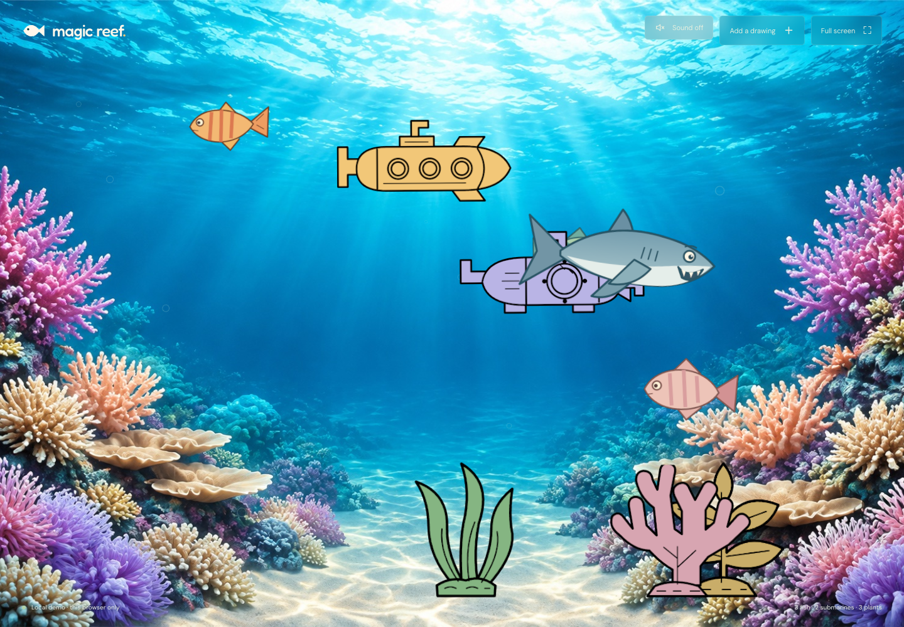
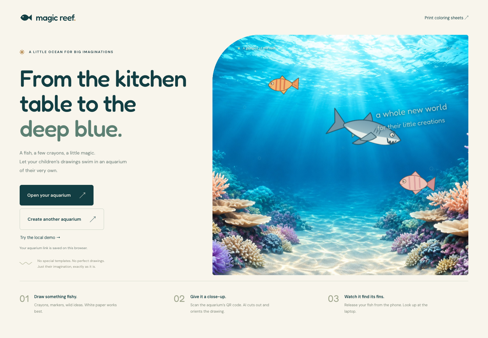

# Magic Reef

**From crayons to coral reefs. A little ocean for big imaginations.**

Turn children's artwork into a living underwater world: fish swim, submarines
cruise, plants grow a paper garden, and a playful shark patrols the reef.
Photograph a drawing on your phone and watch the original artwork join the
aquarium on your laptop—no redrawing, no special templates.

[Open Magic Reef](https://magic-reef.void0.ch) ·
[Print coloring sheets](https://magic-reef.void0.ch/?view=coloring)





A small React + Three.js aquarium for children's drawings. Open the aquarium on
a laptop, scan its QR code with a phone, photograph a drawing, and release
the actual drawing into the water.

The MVP uses flat, transparent fish with subtle swimming deformation instead of
3D fish models. This deliberately preserves each drawing's shape and colors.
Fish swim, submarines cruise, and underwater plants stay anchored on the seabed.
OpenRouter vision analysis automatically identifies the subject type, crop, and head/tail
direction. At **0% AI interpretation**, the app masks and rotates the original photo
pixels without redrawing or recoloring them. An optional slider lets AI repair gaps,
complete coloring, or interpret the artwork more freely, always with approval before
saving. There are no required coloring templates, paid 3D models, or tests.

## Run locally

Requires Node.js 22.12+ (or 20.19+) and npm.

```sh
npm install
cp .env.example .env.local
npm run dev
```

Without environment variables, **Try the local demo** shows the starter aquarium.
Preparing new drawings requires an OpenRouter key even in the local demo.
Uploading also requires the configured owner's GitHub login.
Demo drawings are saved in this browser's local storage; they do **not** sync
between a phone and laptop. The shared aquarium requires Supabase.

## Connect Supabase

1. Create a free project at [supabase.com](https://supabase.com).
2. Open the project's **SQL Editor**, paste all of `supabase/schema.sql`, and run
   it once. Then run `supabase/ai.sql`, `supabase/drawings.sql`, and
   `supabase/party.sql`, `supabase/sizes.sql`, `supabase/movement.sql`, and
   `supabase/unlimited.sql` in that order.
   For an existing aquarium, do not re-run `schema.sql`; run the other two
   scripts, `party.sql`, `sizes.sql`, `movement.sql`, and `unlimited.sql` to add drawing types,
   child names, sizes, and owner-only write permissions.
3. In the project's API settings, find the project URL and **publishable** key
   (the legacy **anon** key also works). Put them in `.env.local`:

   ```dotenv
   VITE_SUPABASE_URL=https://your-project.supabase.co
   VITE_SUPABASE_PUBLISHABLE_KEY=your-publishable-key
   ```

4. Configure GitHub owner login below, then restart the development server.
   **Create an aquarium** now creates a shared
   room with its own permanent, unguessable link.

Never put a Supabase **secret** or **service_role** key in the app or in a
`VITE_` variable. The publishable key is intentionally public; database access
is limited to the SQL functions. Tables have RLS enabled and no direct client
access. Public viewing uses read-only functions; the Vercel server uses
`SUPABASE_SECRET_KEY` for owner-authorized writes. Never expose that key in
browser variables. Supabase Storage and Realtime configuration are not needed.

## GitHub owner login

1. In GitHub **Settings → Developer settings → OAuth Apps**, create an app with
   the site's homepage and the callback URL shown by Supabase GitHub Auth,
   normally `https://YOUR_PROJECT_REF.supabase.co/auth/v1/callback`.
2. Enable GitHub in Supabase Authentication and enter the client ID and secret.
   The OAuth secret belongs **only in Supabase**, never in frontend code.
3. Add the site's URL and local development URL to Supabase's allowed redirects
   (for example `https://your-domain.example/**` and `http://localhost:5173/**`).
4. Set `VITE_AUTH_SUPABASE_URL` and `VITE_AUTH_SUPABASE_PUBLISHABLE_KEY` to this
   authentication project's public configuration. Normally this is the same
   project as the aquarium database. A separate auth project is supported.
5. Set server-only `ALLOWED_GITHUB_USER_ID` to the owner's immutable numeric
   GitHub account ID, and server-only `SUPABASE_SECRET_KEY` to the **aquarium
   database** secret/service-role key. The server verifies each access token
   through Supabase Auth and checks its GitHub identity, not editable user metadata.
6. Apply `supabase/party.sql`. It revokes all old anonymous and authenticated
   write RPCs, including legacy `add_fish`, `add_drawing`, aquarium creation,
   and AI budget reservations. Only the server's privileged role may write.
7. Sign in using **Owner login**. Other accounts cannot upload or prepare
   images, even if they call the API directly. Parents can view without login.
   After the owner's first signup, Supabase new-user signups may be disabled
   for an additional safeguard.

Only this site's session is signed out; other apps using the same auth project
are not signed out. Authentication state is stored in this browser. Habitz's
paused project is not required by the deployed Magic Reef login.

## Deploy to Vercel

1. Import this repository into Vercel. The framework is **Vite**.
2. Add the Supabase, GitHub owner-auth, and OpenRouter variables from
   `.env.example` to the production environment. Keep `SUPABASE_SECRET_KEY`,
   `ALLOWED_GITHUB_USER_ID`, and `OPENROUTER_API_KEY` server-only.
3. Deploy. Vercel runs `npm run build`, publishes `dist`, and deploys
   the analysis and owner-action API functions.
4. Open the deployed HTTPS URL on the laptop, sign in as owner, create an aquarium, and scan the
   QR code on the phone. Leave the aquarium tab visible on the laptop.

Environment variables are baked into the frontend build; redeploy after changing
them. Vercel's HTTPS is important for phone camera and clipboard features.
The photo button uses the native file/camera picker, not a continuous camera feed;
camera-picker behavior depends on the phone's browser. On desktop it opens a file
picker. The separate photo-library button does not request camera capture.

For local phone use, open the network URL printed by Vite **on the laptop first**.
The QR code uses the address of the current page, so `localhost` cannot be scanned
from another device. Both devices need network access to Supabase.

## Connect OpenRouter

1. Create an [OpenRouter](https://openrouter.ai) API key and add credits.
2. Add `OPENROUTER_API_KEY` to `.env.local` for local development and to Vercel's
   environment settings for deployment. **Never prefix this key with `VITE_`**;
   it must stay on the server.
3. Optionally set `OPENROUTER_MODEL` (default: `google/gemini-2.5-flash`). The model
   must support image input and structured JSON-schema output.
4. Optionally set `OPENROUTER_IMAGE_MODEL` (default:
   `google/gemini-2.5-flash-image`) for the interpretation slider. It must support
   reference-image input and image output through chat completions. At 0%, this
   model is not called; the original pixels are used.
5. Run `supabase/ai.sql` if using a shared aquarium, then restart/redeploy.

`npm run dev` serves the same AI handler through Vite middleware, including local
demo uploads. `npm run preview` serves only static files and cannot prepare new
drawings; use the development server or the deployed Vercel site for uploads.

The deployed demo does not allow paid AI requests without a valid shared room.
There are no app-imposed AI attempt, daily usage, or drawing-count caps.
Owner authentication is still required. Each preview update above 0% makes an
image-editing call plus a vision-analysis call. Slider movement alone does not
make requests; press **Update preview** to apply it. AI calls still cost money,
and provider quotas, account credits, hosting resources, and browser storage
remain practical constraints.
The service requests providers that do not collect data (`data_collection: deny`);
model/provider availability depends on those settings.

## Using it

- Draw a fish, submarine, or underwater plant on plain white paper. A dark,
  closed outline and bright colors give the best cutout. Leave paper around the drawing.
- Take a well-lit photo from straight above. Avoid hands, table edges, and
  other drawings in the frame.
- AI automatically identifies the subject and its orientation. Fish/submarines
  become upright horizontal swimmers; plants remain vertical, rooted to the seabed.
  Edge-sampled, shadow-aware paper removal creates the transparent cutout while
  preserving closed white details. Use **Rotate left**, **Rotate right**, or
  **Reset rotation** to correct the approved cutout in 90-degree steps before
  release. Rotation preserves transparency and saves the actual rotated pixels,
  not just a preview transform; it makes no additional AI request.
- Use the **Keep my drawing / Let AI fill it in** slider to choose how much help
  to allow. **0%** preserves original colors, marks, and blank areas. Low settings
  ask for small repairs; higher settings ask AI to fill and interpret more freely.
  The percentage is creative guidance, not an exact pixel-blending strength.
  Press **Update preview** after changing it; release is disabled until the
  preview matches the selected setting. Returning to 0% reuses the original
  preview rather than editing an already generated image.
- Check the cutout preview and optionally give the drawing a name. If the AI missed
  part of the drawing, choose a clearer photo or explicitly retry preparation.
- Release the drawing. The laptop polls every three seconds and downloads only
  drawings it has not loaded before. Refreshing retains the aquarium.
- At upload, **Who drew it?** accepts an optional child's first name or nickname.
  Choose a previously used name or type a new one. It is separate from the drawing's
  own name. Use **Whose drawings?** in the aquarium to see one child's artwork,
  or **Everyone's reef** to see the whole party.
- Open **Reef controls**, then **Copy aquarium link** or **Send to parents**.
  A selected child is included in the viewing link; parents can still switch
  back to everyone. This is a viewing filter, not private access control.
  Sharing sends the existing room's link, not a copy of its database.
  Owner phone-upload QR codes appear only for the signed-in owner.
- Use **Full screen** for an unobstructed view. Escape exits browser fullscreen.
  Created aquariums and successfully opened shared rooms are remembered in local
  storage. Go back to the homepage and select **Open your aquarium** to reopen
  the latest room. This is browser-specific; clearing site data or leaving a private
  browsing session removes the saved link. Bookmark the URL as a backup.
- The **Reef controls** sidebar includes coloring printouts, the child filter,
  sharing links, the owner's upload QR code, login, sound, and fullscreen.
  It opens by default on desktop and can be hidden without stopping audio.
  Printouts open in a new tab and keep a return link to the current aquarium.
  Only the signed-in owner sees these management controls. Anonymous aquarium
  viewers see just sound on/off, fullscreen, and **Whose drawings?** in a compact
  panel, with no printout, sharing, upload, or login controls. They can show
  or hide that panel with the external **Reef controls / Hide controls** button;
  hiding it does not stop the sound. The owner can
  still sign in from the homepage or their upload link.
- Select **Sound off** in the sidebar to enable soft aquarium water-flow
  sound from the supplied `soul_serenity_sounds-water-noises-241049.mp3` recording.
  `public/aquarium-water.wav` is a 20-second mono excerpt with a one-second
  crossfaded loop join. Select **Sound on** to mute. The recording loads only after
  your click, loops using Web Audio, and pauses while the tab is hidden.

## Printable coloring sheets

Open **Print coloring sheets** in the aquarium sidebar or on the homepage (or `/?view=coloring`).
Fourteen original vector sheets (six fish, a crab, a seahorse, an octopus,
two submarines, and three plants) have
closed black outlines, large coloring areas, and clear identifying features.
Print them on landscape A4, one drawing per page, or save a
PDF through the print dialog. Disable browser headers/footers and use 100% scale.
Individual SVG downloads are also available under `public/coloring/`.

Keep the surrounding paper white and the outline visible. Photograph a single
colored sheet from above in good light, with all fins, periscopes, or leaves visible. The sheets are
designed to help recognition, not to guarantee it; always check the AI preview.

The aquarium uses an original AI-generated reef illustration at
`public/reef-background.jpg`, with an open-water center and no baked-in fish.
The same background appears in the homepage preview and shared/demo aquariums;
the drawings and bubbles are animated separately in Three.js. A small UV sway
is masked to the side coral regions, leaving the open water, surface, and central
sand steady. Coral sway is disabled with reduced-motion preferences; uploaded
plant drawings remain stationary.

## Drawing sizes

Choose **Small**, **Medium**, or **Large** before releasing any fish, submarine,
or plant. Medium is the default, including for previously saved drawings.
Fish and submarines are larger than before; Large is a bold centerpiece.
Each fish also gets a stable, ID-based size variation of up to 8% either way,
so companions in the same size category are not identical. Reloading or viewing
on another device keeps that variation; submarines and plants keep their chosen size.
The same saved size is shown on every viewing screen, with responsive fitting
to keep drawings inside narrow aquariums. Size does not redraw the artwork or
make another AI request. Plants remain rooted to the seabed at every size.

Crabs are identified during photo preparation and saved as floor walkers.
They scuttle sideways along the seabed, pause occasionally, and gently move
their legs without floating, tilting, or flipping their artwork. Both the
shark and fishing hook ignore them. Reduced motion disables leg deformation
and slows walking. Older drawings saved before crab recognition retain their
existing behavior; re-upload an old crab to give it the walking classification.

## The playful shark

A friendly shark circles the water and occasionally pursues a randomly chosen
fish. After a brief gulp animation, the fish takes a **15-second break** and then
swims back in. There is **no age protection**, so new fish can be chosen too.
The first pursuit starts after three minutes of visible aquarium time. After each
meal the shark waits at least another three minutes before pursuing a fish.
Unsuccessful pursuits may retry, but never shorten that meal cooldown.
The shark always faces its direction of travel and blinks
occasionally. Gulping and returning happen without notification overlays.
Its body and tail now undulate with the swimming rhythm, without bending its
nose away from its travel direction; reduced motion disables that deformation.

This is a local visual animation, not deletion: drawings remain in Supabase/local
storage, and the fish count includes temporarily hidden fish. Each viewing screen
has its own shark timing. Reloading shows all saved fish again. Animation time
pauses while the tab is hidden; reduced-motion preferences slow the shark and
remove its pitching and chomp stretch.

Submarines and plants are never shark targets. Plants have stable positions
derived from their drawing IDs and do not drift, flip, or wiggle. Submarines
glide more gently than fish and keep their rigid hulls. Existing saved drawings
without a subject type continue behaving as fish.

## The fishing visitor

A little hook with a pink worm occasionally lowers into the water. The first
visit starts after 25–50 seconds; later visits are 30–75 seconds apart. Some
visits leave empty. On others, a fish swims over, takes the worm, and is gently
lifted out. It returns after a **15-second break**, without notifications or
database deletion. The shark and hook never target the same fish at once;
submarines and plants are left alone. Timing is local to each viewer, pauses
while the tab is hidden, and uses gentler movement with reduced motion.

## MVP limits and privacy

- There is no app-imposed drawing-count or AI usage cap. The local demo also
  has three original starter drawings. Large aquariums require more memory,
  rendering work, and storage; local demo storage is constrained by the browser.
- Selecting a photo sends a resized JPEG (at most 1600 pixels on its longest side)
  through the Vercel function to **OpenRouter and its selected AI provider** for
  analysis and, when interpretation is above 0%, image editing.
  Do not photograph faces, names, or other personal details. Consult their
  data-processing policies before using children's artwork.
  Photos are not stored by this application's server, and photo data/API keys are
  not logged. Only the approved PNG cutout, name, aspect ratio, orientation,
  and subject type are stored in Supabase. Cutouts are at most 600 pixels on their longest side and 700 KB
  including base64 encoding. The input photo limit is 25 MB.
- Supabase's database stores the PNG data directly for simple MVP deployment.
  Full-size image storage, realtime subscriptions, and a management UI can be
  added later if needed.
- **The aquarium link grants viewing access.** Anyone with it can view drawings
  and associated first names; only the signed-in GitHub owner can add drawings.
  Share it only with trusted people. There are no public room lists.
  Sharing an upload link does not authorize uploads, but still grants viewing access.
  Use first names or nicknames, not full names or other identifying details.
- Data persists until the Supabase project owner removes it. There is no
  automated expiration or in-app deletion in this MVP. To delete a room, delete
  its row in the `tanks` table using Supabase's Table Editor; its fish cascade-delete.
- Owner-only tank creation has a 1,000-room deployment cap and per-tank uploads
  are capped/validated server-side. This is intended for a small, trusted-family
  deployment, not a large public service. Public launch needs additional abuse
  controls, storage budgeting, deletion/retention UX, and a privacy policy.
- AI crop detection and automatic paper removal are approximate, not a
  pixel-perfect segmentation model. Use plain, light paper and a closed dark outline.
  Strong shadows, perspective, crowded photos, or unusual drawings can yield
  imperfect cutouts; the preview is authoritative. At 0%, AI does not redraw or
  recolor the fish, and closed white interiors are preserved. Higher interpretation
  settings can change the artwork or invent details; check the preview carefully.
  Existing saved fish are not automatically reprocessed. JPEG and PNG are the most portable inputs; unsupported
  phone formats show an error rather than uploading a broken fish.
- Requires a WebGL-capable browser. Fish are readable 2D artwork moving in a
  Three.js scene, not anatomically modeled 3D animals.
- Fonts are loaded from Google Fonts with local fallbacks. Fish/photo data is
  not sent there.

## Commands

```sh
npm run dev      # development server
npm run build    # TypeScript check and production build
npm run preview  # serve the production build locally
```

Inspired by the idea behind
[MrMoT9I/paper-aquarium](https://github.com/MrMoT9I/paper-aquarium), with an
independent implementation, original sample artwork, and no borrowed fish models
or assets.
